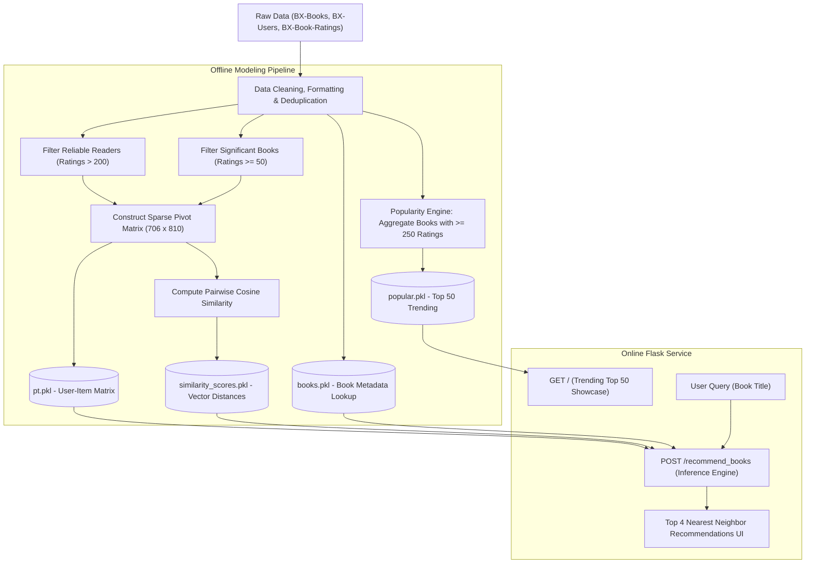

# Book Recommender System 📚

[](https://www.python.org/)
[](https://flask.palletsprojects.com/)
[](https://scikit-learn.org/)
[](https://pandas.pydata.org/)
[](LICENSE)
[](https://github.com/nitesh28ku)

An end-to-end Machine Learning web application delivering personalized book recommendations by blending **Popularity-Based Filtering** and **Collaborative Filtering** (User-Item Matrix Factorization using Cosine Similarity). Built with Python, Flask, Pandas, NumPy, Scikit-learn, and a responsive Bootstrap UI.

---

## 📌 Executive Summary

With hundreds of thousands of published books across countless genres, readers often face decision paralysis when searching for their next read. Standard keyword queries can only surface books a user already knows by name, failing to uncover latent affinities across author style, themes, and community reception.

This project addresses discovery friction with a dual-paradigm recommendation system:
1. **Curated Trending Catalog (Popularity-Based Filtering)**: Solves the classic "cold-start" problem for new or unregistered users by computing and displaying the Top 50 highest-rated books across the platform using an activity threshold (minimum 250 ratings).
2. **Personalized Similarity Engine (Collaborative Filtering)**: Constructs a high-density reader-item interaction matrix and computes pairwise cosine similarity across multidimensional reading profiles, delivering the 4 most relevant recommendations for any selected book.

---

## 🏛️ System Architecture



---

## 🔬 Core Algorithms & Technical Breakdown

### 1. Popularity-Based Recommender (Mitigating Cold Start)
To ensure recommendations represent genuine consensus quality rather than statistical anomalies (such as a book with a single 10/10 rating), the system enforces a strict vote-count threshold:
- **Threshold Criterion**: Only books with at least $250$ total submitted ratings are considered.
- **Aggregation Metric**: Books are ordered by average rating:
  $$\text{Score}(b) = \frac{1}{|R_b|} \sum_{r \in R_b} r \quad \text{subject to } |R_b| \ge 250$$
- **Top 50 Selection**: The top 50 books are stored with cover imagery, author attributes, total vote tallies, and mean scores for instantaneous delivery on the landing page.

### 2. Collaborative Filtering (Item-Based Cosine Similarity)
The personalized recommendation engine models collective human taste by analyzing patterns across active readers:

1. **Dimensionality & Sparsity Reduction**:
   - Readers with fewer than $200$ total ratings are filtered out to preserve high-fidelity taste profiles.
   - Books with fewer than $50$ ratings are excluded to avoid noise.
   - The resulting interaction space forms a compact 2D pivot matrix:
     $$\mathbf{M} \in \mathbb{R}^{706 \times 810}$$
     where rows represent $706$ candidate books, columns represent $810$ frequent raters, and values represent rating intensities ($0$ to $10$).

2. **Vector Space & Cosine Similarity Metric**:
   Each book $i$ is represented as an 810-dimensional rating vector $\mathbf{v}_i$. The angle between any two book vectors $\mathbf{u}$ and $\mathbf{v}$ defines their aesthetic proximity:
   $$\text{Cosine Similarity}(\mathbf{u}, \mathbf{v}) = \frac{\mathbf{u} \cdot \mathbf{v}}{\|\mathbf{u}\|_2 \|\mathbf{v}\|_2} = \frac{\sum_{k=1}^{n} u_k v_k}{\sqrt{\sum_{k=1}^{n} u_k^2} \sqrt{\sum_{k=1}^{n} v_k^2}}$$

3. **Inference & Neighbor Extraction**:
   - Given a query title $T$, locate its row index in matrix $\mathbf{M}$.
   - Retrieve its corresponding similarity array from `similarity_scores.pkl`.
   - Sort indices by descending similarity score:
     $$\text{Neighbors}(T) = \operatorname{arg\,top}_4 \left( \{ \text{sim}(T, b) \mid b \in \mathcal{B} \setminus \{T\} \} \right)$$
   - Join neighbor indices with `books.pkl` metadata to return titles, authors, and cover art.

---

## 📊 Data Dictionary & Schemas

### Raw Book-Crossing Dataset
| Entity / File | Attribute | Type | Description |
|---|---|---|---|
| **BX-Books** | `ISBN` | String | Unique standard book identifier |
| | `Book-Title` | String | Title of the publication |
| | `Book-Author` | String | Author / Writer |
| | `Year-Of-Publication` | Integer | Year of release |
| | `Publisher` | String | Publishing entity |
| | `Image-URL-M` | String | Direct URL to medium-sized book cover thumbnail |
| **BX-Users** | `User-ID` | Integer | Unique identifier for registered reader |
| | `Location` | String | Demographic location (City, State, Country) |
| | `Age` | Float | Reader age |
| **BX-Book-Ratings** | `User-ID` | Integer | Foreign key reference to BX-Users |
| | `ISBN` | String | Foreign key reference to BX-Books |
| | `Book-Rating` | Integer | Rating score (0 indicates implicit read, 1–10 explicit score) |

### Serialized Model Artifacts
- **`popular.pkl`** (`DataFrame`): Pre-computed table containing the top 50 trending books with title, author, cover URL, rating count, and average score.
- **`pt.pkl`** (`DataFrame`): Pivot matrix index of shape $(706, 810)$ mapping book titles against active user rating profiles.
- **`similarity_scores.pkl`** (`ndarray`): Pre-computed pairwise cosine distance matrix of shape $(706, 706)$ enabling constant-time $O(1)$ similarity vector retrieval.
- **`books.pkl`** (`DataFrame`): Deduplicated lookup table containing complete book catalog metadata for presentation rendering.

---

## 📂 Project Directory Structure

```plaintext
Book-recommender-system/
│
├── templates/
│   ├── index.html                  # Landing page showcasing Top 50 trending books
│   └── recommend.html              # Search and dynamic recommendation interface
│
├── Book recommender system.ipynb   # Exploratory Data Analysis & Model Training Notebook
├── app.py                          # Flask application server and routing logic
├── books.pkl                       # Serialized book metadata dictionary
├── popular.pkl                     # Serialized Top 50 popularity dataframe
├── pt.pkl                          # Serialized user-book interaction pivot table
├── similarity_scores.pkl           # Serialized pairwise cosine similarity matrix
├── requirements.txt                # Python environment package dependencies
├── .gitignore                      # Git exclusion rules for clean repository state
├── LICENSE                         # MIT License
└── README.md                       # Comprehensive documentation
```

---

## ⚡ Setup & Execution Instructions

### Prerequisites
- Python 3.9, 3.10, 3.11, 3.12, or 3.13
- Git

### 1. Clone Repository
```bash
git clone https://github.com/nitesh28ku/Book-recommender-system.git
cd Book-recommender-system
```

### 2. Environment Setup
Create and activate an isolated virtual environment:

```bash
# macOS / Linux
python3 -m venv venv
source venv/bin/activate

# Windows (PowerShell)
python -m venv venv
.\venv\Scripts\Activate.ps1
```

### 3. Install Required Packages
```bash
pip install --upgrade pip
pip install -r requirements.txt
```

### 4. Launch Application
```bash
python app.py
```
After starting the server, access the live portal in your browser:
```text
* Running on http://127.0.0.1:5000/ (Press CTRL+C to quit)
```

---

## 🌐 Application Endpoints

| Endpoint | Method | Functionality |
|---|---|---|
| `/` | `GET` | Displays curated Top 50 Books catalog with covers, authors, votes, and ratings. |
| `/recommend` | `GET` | Displays book recommendation search page. |
| `/recommend_books` | `POST` | Accepts a book title query, queries the cosine similarity matrix, and renders the top 4 matched recommendations. |

---

## 📈 Key Insights & Business Rationale

- **High-Quality Signal-to-Noise Ratio**: Filtering out casual readers with $< 200$ reviews removes spam and uncalibrated ratings, ensuring the collaborative filter reflects genuine consensus among avid book enthusiasts.
- **Sub-Millisecond Inference**: By precomputing the cosine similarity matrix offline during model training, production inference runs in $O(N \log K)$ time where $K=4$, guaranteeing instant response times under concurrent user load.
- **Zero Friction Onboarding**: The dual-engine architecture ensures that first-time visitors with no prior rating history immediately experience an engaging, content-rich catalog rather than empty states.

---

## 📄 License
This project is open-source and distributed under the [MIT License](LICENSE).

---

## 👨‍💻 Author
**Nitesh Kumar**
- **GitHub**: [@nitesh28ku](https://github.com/nitesh28ku)
- **Email**: [niteshkumar190904@gmail.com](mailto:niteshkumar190904@gmail.com)
